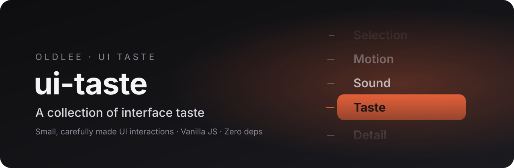
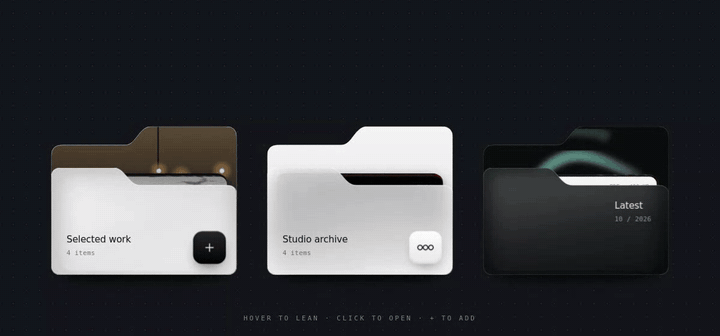

<div align="center">



<h1>ui-taste</h1>

<p><b>Small, carefully made UI interactions, recreated from the best ideas I come across.</b><br>
Vanilla JavaScript · Zero dependencies · Copy and use</p>

<p>
<a href="https://old.lat/ui-taste/"></a>


</p>

<p><a href="README.md">简体中文</a> · <b>English</b></p>

</div>

<br>

## Why

Good interfaces usually win on details that are hard to name: the weight of a bounce, a click that lands at exactly the right moment, a soft fade at the edge.
Every piece here is an interaction I saw in the design world and couldn't resist building myself.

Not "roughly like it". Each one is **matched frame by frame against the reference**, down to sizes, spacing, timing and sound, then packaged as a clean, reusable component anyone can drop in.

<br>

## Components

<table>
<tr>
<td width="46%" valign="top">
<a href="components/wheel-dropdown"></a>
</td>
<td valign="top">

### Wheel Dropdown · 滚轮下拉

> Dropdowns don't have to drop down.

Click it and the menu opens in place as a wheel: items curve along an arc, fade and blur toward the edges, tick marks turn with the scroll, and each step makes a soft click.

- Scroll, drag, or use ↑ ↓
- Enter or click to pick, Esc to cancel
- Built-in Web Audio click, can be turned off
- Light and dark themes

[**Live demo →**](https://old.lat/wheel-dropdown/) &nbsp;·&nbsp; [Code & docs](components/wheel-dropdown)

<sub>Idea by <a href="https://ohwow.design">@omer_assa</a> · "Dropdowns don't have to drop down."</sub>

</td>
</tr>
<tr>
<td width="46%" valign="top">
<a href="components/glass-folders"></a>
</td>
<td valign="top">

### Glass Folders · 玻璃文件夹

> When cards can be put away.

Three folders, one screen, no scrolling. Hover and the frosted glass leans toward you; click and the cards stand up and fan out. Drop a new card in and the pocket sinks a little.

- Bottom hinge: leans on hover, further when open
- Cards fan out with a spring
- \+ adds a card that drops in and weighs the pocket down
- ooo glass menu: Close / Rename / Share / Move to Trash

[**Live demo →**](https://old.lat/glass-folders/) &nbsp;·&nbsp; [Code & docs](components/glass-folders)

<sub>Idea by VG Studio · Xiaohongshu 「当卡片可以收纳」</sub>

</td>
</tr>
</table>

<p align="center"><sub>More on the way · every piece credits its original designer</sub></p>

<br>

## Quick start

Each component lives in `components/<name>/` as one `.js` and one `.css` file. No build step.

```html
<link rel="stylesheet" href="wheel-dropdown.css">

<div id="country"></div>

<script src="wheel-dropdown.js"></script>
<script>
  new WheelDropdown(document.getElementById('country'), {
    items: [
      { value: 'jp', label: 'Japan',  icon: '<svg>…</svg>' },
      { value: 'fr', label: 'France', icon: '<svg>…</svg>' }
    ],
    value: 'jp',
    onChange: item => console.log(item.value)
  });
</script>
```

<br>

## Principles

| | |
|---|---|
| **Faithful** | Sizes, spacing, easing and sound matched to the reference, not just the idea. |
| **Zero deps** | Plain JS and CSS, no framework. Two files and you're done. |
| **Accessible** | Keyboard and screen-reader support wherever the pattern allows. |
| **Two themes** | Light and dark out of the box. |
| **Credited** | Every piece names its original designer and source. |

<br>

## Structure

```
ui-taste/
├── index.html                 # gallery (live demo home)
├── assets/                    # preview GIF / MP4 / banner
└── components/
    ├── wheel-dropdown/
    │   ├── wheel-dropdown.js
    │   ├── wheel-dropdown.css
    │   ├── flags.js           # flag SVGs for the demo
    │   ├── index.html         # standalone demo
    │   └── README.md
    └── glass-folders/
        ├── glass-folders.js
        ├── glass-folders.css
        ├── index.html
        └── README.md
```

<br>

## Credits & license

Interaction ideas belong to their designers and are credited in each component. Code by [Oldlee](https://eeoo.dev), released under [MIT](LICENSE).

Seen an interaction that made you stop scrolling? Suggest it in an [issue](https://github.com/Oldleeo/ui-taste/issues).

<div align="center"><br><sub>Made with taste in Kuala Lumpur.</sub></div>
