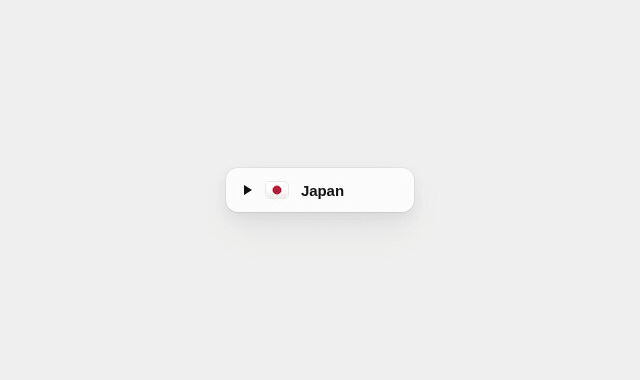

<div align="center">

# ui-taste

**老李的 UI 审美收藏** · Small, carefully made UI interactions, recreated from the best ideas I come across.

Vanilla JS · zero dependencies · copy and use

[**Live demo →**](https://old.lat/ui-taste/)

</div>

---

## Components

| | Component | What it does | Demo |
|---|---|---|---|
|  | **Wheel Dropdown** · 滚轮下拉 | A dropdown that opens in place as a wheel, with arc ticks and a soft click per step. 下拉不一定要往下拉。 | [Open](https://old.lat/ui-taste/components/wheel-dropdown/index.html) · [Code](components/wheel-dropdown) |

More soon · 持续收录中

## Use one

Each component lives in `components/<name>/` as one `.js` and one `.css` file. No build step.

```html
<link rel="stylesheet" href="wheel-dropdown.css">
<div id="country"></div>
<script src="wheel-dropdown.js"></script>
<script>
  new WheelDropdown(document.getElementById('country'), {
    items: [
      { value: 'jp', label: 'Japan',  icon: '<svg>…</svg>' },
      { value: 'fr', label: 'France', icon: '<svg>…</svg>' }
    ],
    value: 'jp',
    onChange: item => console.log(item.value)
  });
</script>
```

## Principles

- Match the reference closely: sizes, spacing, timing, sound. Not just the idea.
- Keyboard and screen-reader friendly where the pattern allows.
- Light and dark.
- Credit the original designer on every piece.

## Credits

Ideas belong to their designers and are credited in each component. Code by [Oldlee](https://eeoo.dev), MIT.
